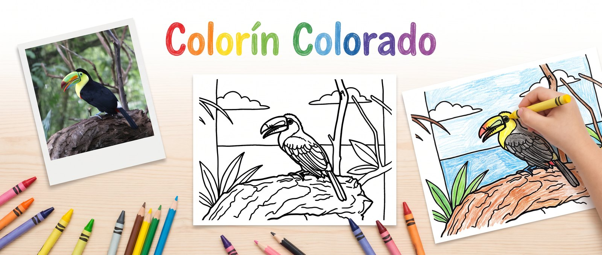
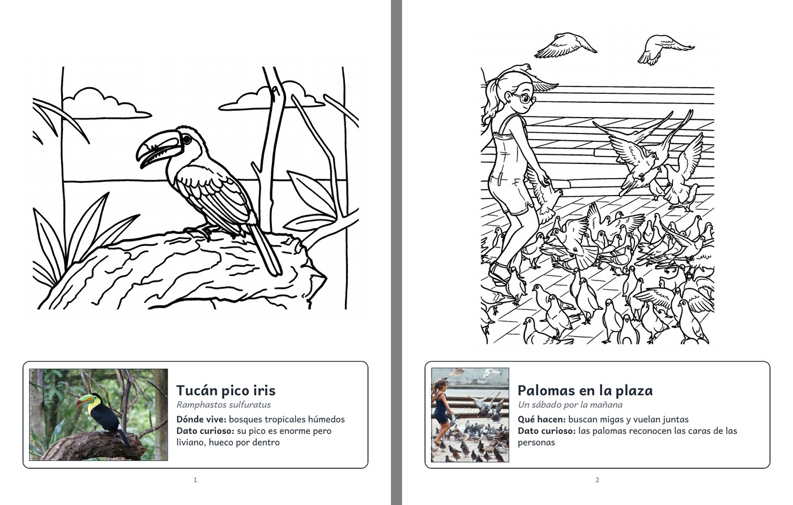
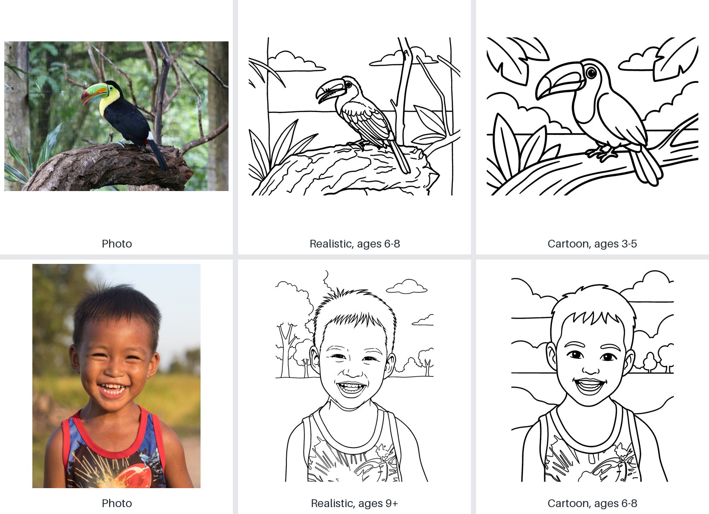
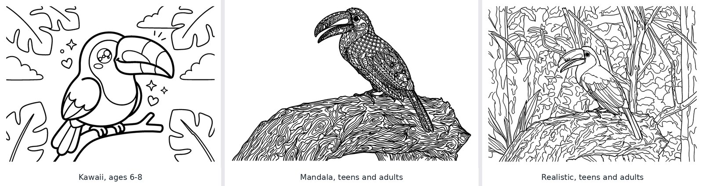
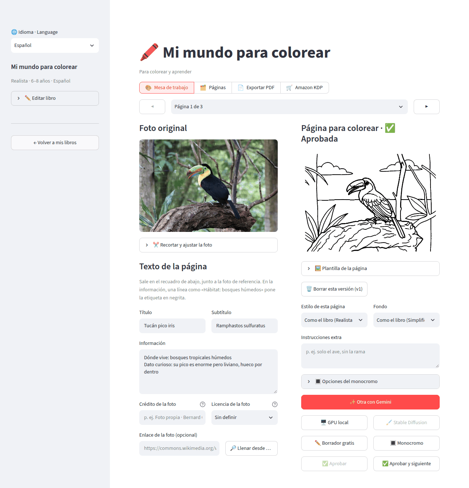
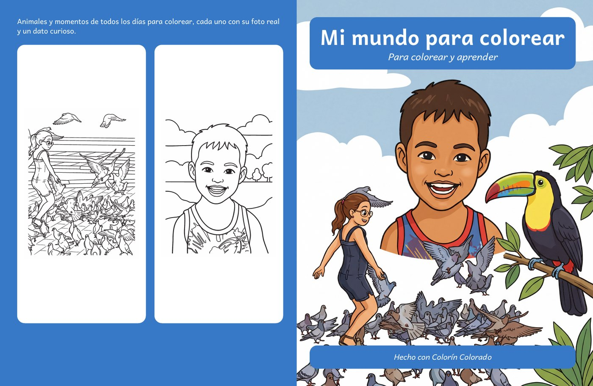

  

# 🖍️ Colorín Colorado

Turn your own photos into a coloring book for kids, to print at home or to sell on Amazon.

Upload photos, convert them one by one into black-and-white line art, write a line about what
each page shows, and export a PDF where every coloring page carries the real photo and an info
box. A bird book shows the real bird and where it lives; a book of landmarks shows a small photo
of the place; a family album shows the day the photo was taken.

> *Colorín colorado, este cuento se ha acabado.* The Spanish line that closes a children's story,
> the way [Once Upon a Time](https://github.com/JohnBetaCode/Once_Upon_a_Time) opens one.

## From photo to coloring page

Pick a style (realistic, cartoon, kawaii or mandala) and an age group (3–5, 6–8, 9+, adults). The photo is always the
reference, so the toucan stays a keel-billed toucan and the boy stays the same boy.

Two more styles, kawaii and mandala, and a level with fine lines for teens and adults:

Whatever the model returns, the page that reaches the PDF is pure black and white: copied colors
are dropped, solid black areas become outlines, lines are thickened for small hands, and a
"photo of a printed page" is cut down to the drawing. See the [spike](docs/spike.md) for what
the model gets wrong and how each case is handled.

## The workbench

One page at a time: the photo and its caption on the left, the coloring page and its versions on
the right. Crop, convert, regenerate with instructions, approve, next.

## Sell it on Amazon

The **🛒 Amazon KDP** view turns the book into the two files Amazon's print-on-demand service asks
for: an interior that meets KDP's specs, and a wraparound cover (back, spine and front) sized to
the page count. The front can be one of your coloring pages, an image you upload, or a color
illustration the AI draws from a collage of your pages, a description, or the book's theme. The
view also estimates the printing cost and your royalty on Amazon.com, Amazon.co.uk or the EU
stores, lists what to fix before uploading (photo licenses included), drafts the product page
(description, keywords, categories) and makes the images for it: a 3D mockup and a look inside.

## What you get

- **Any photos.** JPG, PNG, WebP or HEIC straight from the phone, or a Wikimedia Commons link,
  which brings its author and license along.
- **Four styles, four ages, four kinds of book.** Realistic, cartoon, kawaii or mandala; line
  weight and detail follow the age group; templates for nature, landmarks and family albums
  suggest what each page says.
- **Convert the whole book at once**, or page by page in the workbench.
- **Versions, never lost.** Every conversion and every cover image is kept; pick the one you like.
- **A free draft mode** to lay out a book before spending anything.
- **Activities from your own pages**: a word search with the book's words, a maze, a
  connect-the-dots traced from a drawing, their solutions, a color test page, a diploma and a
  closing page.
- **Bilingual books**: every caption in Spanish and English, translated by the AI and editable.
- **Photo rights in check**: each photo's license, credits on the copyright page, and photos that
  cannot be sold flagged before you upload.
- **A print-ready PDF**: title page, copyright page with the photo credits, "this book belongs
  to" page, one coloring page per sheet with the reference photo and caption, in Letter, A4,
  8 × 10 or square, with blank backs so markers never bleed into another drawing.
- **Ready for Amazon KDP**: interior and cover files, cost and royalty in three stores, a
  pre-upload checklist, the product page drafted, and images for it.
- **Spanish and English**, for the app and for each book.
- **Duplicate a book, or move it as a ZIP** to back it up or open it on another computer.
- **Your choice of access to Gemini**: a Google Cloud project, or just an API key.
- **Costs in sight.** About $0.14 per AI conversion; the tokens and cost of every call are
  tracked per book and in total.

## Try it

The [setup guide](docs/setup.md) gets it running with Docker in a few minutes, then open
http://localhost:8502 and create your first book.

## Learn more

- [Setup](docs/setup.md): requirements, running, configuration, tests, troubleshooting.
- [User guide](docs/usage.md): a book from start to finish, captions, export options, costs.
- [Selling on Amazon](docs/amazon-kdp.md): KDP file specs, costs and royalties, AI disclosure,
  photo rights, taxes and payments.
- [Architecture](docs/architecture.md): modules, data layout, pipelines, design decisions.
- [Plan](docs/plan.md) and [line-art spike](docs/spike.md).

## Other notes

- **Development cost**: building this repository cost about **$8.64** in Gemini calls (54 calls,
  50 images, 137,355 tokens), mostly the line-art spike. The breakdown is in
  [docs/development-cost.md](docs/development-cost.md).

Sample photos from Wikimedia Commons: toucan by Bernard Gagnon (CC0), laughing boy by Basile Morin
(CC BY-SA 4.0), girl with pigeons by Ken Ketch (CC BY 2.0). The banner and the cover illustration
were drawn by Gemini from them.
