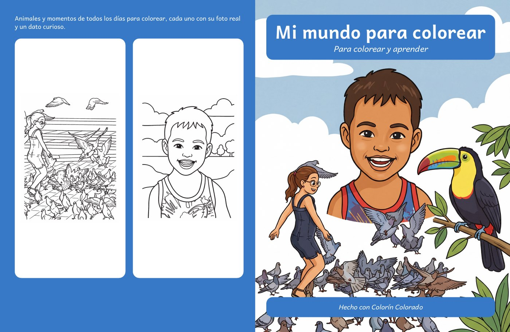

# Selling on Amazon (KDP)

Everything needed to sell a Colorín Colorado book as a paperback through Kindle Direct Publishing
(KDP): the file formats Amazon asks for, what printing costs and what you earn, the rules on AI
content and photo rights, and what changes when you sell from outside the United States.

Checked against the KDP help pages on **2026-10-31** ([sources](#sources)). KDP changes prices and
rules from time to time. The numbers the app uses live in `app/core/kdp.py`; when KDP changes them,
update that module, this page and `tests/test_kdp.py` together.

## The short version

1. **Rights first.** Only use photos you took yourself or whose license allows commercial use and
   derivatives ([Rights to the photos](#rights-to-the-photos)). Set each photo's license and
   credit in the workbench.
2. **Finish the book.** Approve every page, check every drawing for AI mistakes, and type the
   captions.
3. **Export settings** (📄 Export PDF): the size, **blank backs on**, the extra pages you want,
   and the copyright page text.
4. **🛒 Amazon KDP view**: pick the ink and the store, set the price, fix everything marked as an
   error, and draft the product page in **📝 Amazon listing**.
5. **Build both files**: the interior from 📄 Export PDF and the cover from 🛒 Amazon KDP, with
   the same page count. Give the cover a color image first: uploaded, or drawn by the AI.
6. **On KDP**: create a paperback, fill in the details from the listing, answer **yes** to
   AI-generated images, upload both PDFs with the settings the KDP view lists, check the online
   previewer, **order a proof copy**, and publish. The listing images help with A+ content and
   social media.

## Interior file

| KDP requirement | Value | How the app meets it |
|---|---|---|
| Format | PDF | 📄 Export PDF |
| Trim size | 8.5 × 11 in is the usual size for coloring books. 8.27 × 11.69 in (A4), 8 × 10 in and 8.5 × 8.5 in also exist | All four: Letter, A4, 8 × 10 and square |
| Page count, 8.5 × 11 in and 8.5 × 8.5 in | Black ink: 24–590. Standard color: 72–600. Premium color: 24–590 | The KDP view counts the interior's pages and flags anything out of range |
| Page count, 8 × 10 in | Black ink: 24–828. Standard color: 72–600. Premium color: 24–828 | Flagged |
| Page count, A4 | Black ink: 24–780. Standard color: **not offered**. Premium color: 24–590 | Flagged |
| Bleed | Only needed when ink reaches the edge of the page. Bleed adds 0.125 in to the width and 0.25 in to the height | Nothing reaches the edge: choose **No Bleed** |
| Outside, top and bottom margins | At least 0.25 in without bleed | 0.5 in |
| Inside margin (gutter) | 24–150 pages: 0.375 in. 151–300: 0.5 in. 301–500: 0.625 in. 501–700: 0.75 in. 701–828: 0.875 in | 0.5 in on every side, enough up to 300 pages; above that the KDP view says to split the book |
| Image resolution | 300 DPI or more | Line art is upsampled to at least 300 ppi where it would print below that (a page with no caption box). Reference photos print at about 400–580 ppi |
| Fonts | All fonts embedded | Andika is embedded, including ReportLab's default page font. The Helvetica fallback outside Docker is not embedded, so the KDP view flags exports made without Andika as an error |
| Printing | Always double-sided, perfect bound (glued spine) | **Blank backs** put every drawing on a right-hand page with nothing printed behind it, so markers never bleed into another drawing |
| Blank pages | KDP may add blank pages at the end; that is expected | — |

What the interior contains, in order:

1. **Title page**: title, subtitle, the cover page's line art, dedication.
2. **Copyright page**, on the back of the title page: the text from 📄 Export PDF (© year and
   author, "All rights reserved", edition, ISBN) and the photo credits (`p. 3 · Toucan: Bernard
   Gagnon, CC0`). It is printed only when there is text or at least one credit; otherwise that page
   is blank (with blank backs) or skipped.
3. **"This book belongs to"** page, plus a blank back (both optional), and the **color test** page
   if chosen.
4. **One coloring page per sheet**, each followed by a blank back.
5. The chosen **extra pages**: word search, maze, connect-the-dots, solutions, diploma, closing
   page, each followed by a blank back.

With blank backs and the owner page, the interior has `4 + 2 × (drawings + extra pages)` pages:
10 drawings is the 24-page minimum (or 7 drawings and 3 extras), and 50 drawings make 104 pages.

## Cover file

KDP wants **one PDF** with the back cover, the spine and the front cover side by side. 🛒 Amazon
KDP → **Build cover** makes it for the interior the book exports now.

| KDP requirement | Value | How the app meets it |
|---|---|---|
| Size | Width = 0.125 + trim width + spine + trim width + 0.125 in. Height = 0.125 + trim height + 0.125 in | `kdp.cover_size` |
| Spine width | Pages × 0.002252 in (white paper, black ink or standard color), × 0.002347 in (premium color), × 0.0025 in (cream paper) | 104 pages on white paper: 0.234 in, so the cover is 17.484 × 11.25 in |
| Spine text | Only from 79 pages, at least 0.0625 in from each spine edge | The title goes on the spine when it fits at 5 pt or more, from about 96 pages |
| Safe area | Text at least 0.125 in inside the trim; nothing from the front or back in the spine | Everything stays 0.375 in inside the trim |
| Barcode | KDP prints it in a 2 × 1.2 in white box in the lower right of the back cover, about 0.25 in from the spine and the bottom edge | That corner is left empty |
| Resolution | 300 DPI | Line art is upsampled to at least 300 ppi. A cover image needs about 2600 × 3400 px to fill the front at 300 ppi (Letter); AI images are drawn in 4K (3584 × 4800 px, about 415 ppi), and the KDP view warns about smaller uploads |
| Color | CMYK, one color space, no spot colors; KDP removes ICC profiles | All CMYK: the background, the text, the line art (black on the K plate only), and the cover image, converted through a coated-paper press profile (Ghostscript's, with LittleCMS), which keeps the total ink near 300%. No profile is embedded |
| File size | Under 650 MB; 40 MB or less recommended | A few hundred KB with line art; a few MB with a cover image |

The cover file name carries the page count it was sized for (`<slug>-cover-104p-<time>.pdf` under
`exports/covers/`). If the interior changes (pages added, owner page or blank backs switched), the
KDP view warns that the cover is stale: build it again.

**The front.** The cover is the most important thing on the product page, and most coloring books
show a colored-in drawing. The front can carry:

| Front | How | AI content for KDP? |
|---|---|---|
| The cover page's drawing, uncolored, in a white panel | Default | Only if that page was converted with AI |
| An image you upload | 🛒 Amazon KDP → Front cover image → 📤 Upload an image | No, unless an AI made it |
| A collage of up to six pages, colored in with the real colors of their photos | ✨ Generate with AI → A collage of pages | **Yes** |
| An illustration of a description you write | ✨ Generate with AI → A description | **Yes** |
| An illustration of the book's theme (title, subtitle, page titles) | ✨ Generate with AI → The book's theme | **Yes** |

An image fills the front to the edge of the paper, cropped to fit, with the title and subtitle on
a label in the background color at the top and the dedication on another at the bottom. The AI is
asked for no text in the image (the title is set by the app, so it is always spelled right) and a
calm top quarter for the label. Each image is kept as a version; switch between them at any time.

**The back** has the back cover text and up to four more pages as line art; **the spine**, the
title once it fits.

You can instead build the cover with KDP's **Cover Creator** and upload only the interior.

## Ink and paper: the reference photo

KDP prints the interior in **one** ink for the whole book. With black ink the color reference photos
print in grayscale, which takes away much of their point in a bird book.

Prices for 50 drawings with blank backs (104 pages, 8.5 × 11 in, Amazon.com):

| Interior ink | Printing cost | Example price | Royalty per copy | Notes |
|---|---|---|---|---|
| Black | $2.84 | $9.99 | **$3.15** | Cheapest. Photos print in gray |
| Standard color | $5.18 | $12.99 | $2.61 | 72 pages minimum; not in A4 |
| Premium color | $9.32 | $19.99 | $2.67 | Heavier paper (spine factor 0.002347 in per page) |

Blank backs are paid at the color rate too. Recommendation: **black ink at $9.99** for books where
color does not matter much; **standard color** for a bird guide or similar, where the color
photo is the point. Cream paper is meant for novels and changes how colors look: use white.

## Costs and royalties

**Printing cost per copy**. Every size the app offers is a "large" trim (wider than 6.12 in or
taller than 9 in):

| Ink | Pages | Amazon.com (USD) | Amazon.co.uk (GBP) | Amazon.es and EU (EUR) |
|---|---|---|---|---|
| Black, white paper | 24–108 | $2.84 flat | £2.15 flat | €2.48 flat |
| Black, white paper | 110–828 | $1.00 + $0.017/page | £0.85 + £0.012/page | €0.75 + €0.016/page |
| Standard color | 72–600 | $1.00 + $0.0402/page | £0.85 + £0.027/page | €0.75 + €0.035/page |
| Premium color | 24–40 | $4.20 flat | £3.24 flat | €3.61 flat |
| Premium color | 42–828 | $1.00 + $0.08/page | £0.85 + £0.0598/page | €0.75 + €0.0715/page |

Since black ink costs the same for any count under 110 pages, **up to 52 drawings** (108 pages with
blank backs) costs the same to print as 10.

**Royalty** = rate × list price − printing cost.

| Marketplace | 50% rate | 60% rate |
|---|---|---|
| Amazon.com | price ≤ $9.98 | price ≥ $9.99 |
| Amazon.es | ≤ €9.98 | ≥ €9.99 |
| Amazon.co.uk | ≤ £7.98 | ≥ £7.99 |

The 50% band started on 2025-06-10. In the UK and EU stores **the list price is before VAT**:
Amazon adds the local VAT on top, and the royalty is computed on the list price. **Expanded
Distribution** (bookstores, libraries) pays 40% of the list price minus printing. The **minimum
list price** is printing cost ÷ royalty rate; the maximum on Amazon.com is $250. The KDP view
estimates all three stores (pick one under **Store**); other stores, like Japan or Australia, are
not covered.

## Content rules

**AI disclosure is mandatory.** When you publish (or republish an edited book), KDP asks about AI
content. Images "created by an AI-based tool" must be declared **even if you edited them
substantially**, including interior and cover images. In this app:

| Content | AI-generated for KDP? |
|---|---|
| Pages converted with **✨ Gemini**, **🖥️ Local GPU** or **🖌️ Stable Diffusion** | **Yes** |
| Pages from the **✏️ Free draft** (OpenCV, no AI) | No |
| Captions, back cover text and copyright text you typed | No |
| AI caption suggestions (phase 2), if used as written | Yes (text) |
| A cover image drawn by the AI (collage, description, theme) | Yes |
| A cover image you upload, made without AI | No |

AI-*assisted* content (you made it and used AI to edit or check it) does not need declaring. The
KDP view reminds you when any selected page, or the cover image, came from the AI.

**Model licenses.** Besides declaring AI content, you need the right to sell what the model drew.
The local GPU engine's default model, Qwen-Image-2.1, is under the Qwen Research License (research
and evaluation only), so its pages cannot be sold without a commercial agreement with Alibaba;
every version records its model and the KDP view warns about each selected page drawn with it. FLUX.1 Kontext [dev], the usual Stable
Diffusion model, is under a non-commercial license too: check it before selling those pages.

**Quality.** KDP removes content that is "typically disappointing to customers". For coloring
books that means drawings with AI mistakes (extra legs, broken shapes, garbled details), blurry or
gray lines, and repeated pages. Review every page before approving it and **order a proof copy**:
it is the only way to see the line weight and the paper for real.

**Publishing limits.** KDP limits how many new titles you can create per format each week. An
older help-page snippet says 10 per format per week; reports from September 2026 say it dropped to
2. Check the current limit in KDP before planning several books at once.

**Copyright of AI images.** In the United States, images generated by AI without enough human
authorship are generally not protected by copyright, so others could copy your pages. Your
captions, your texts and the selection and arrangement of the book are yours. This is not legal
advice: ask a lawyer before relying on it.

## Rights to the photos

Selling a book is commercial use, and a coloring page traced from a photo is a **derivative work**
of that photo. Before using a photo, check:

| Photo | Can it go in a book for sale? |
|---|---|
| Taken by you | Yes |
| Public domain or CC0 | Yes |
| CC BY | Yes, **with the credit printed in the book** (the photo credit field) |
| CC BY-SA | Yes with credit, but the derived drawing must be shared under CC BY-SA too, so anyone may copy that page. Better avoided |
| Any license with **NC** (non-commercial) | **No** |
| Any license with **ND** (no derivatives) | **No**: a coloring page is a derivative |
| Stock photos | Only if the license allows derivatives in products for sale. Read it: many standard licenses restrict products whose main value is the image |
| Found on Google or social media | **No** |

In the app, every page has a **license** (the options above) next to its credit. The KDP view
**blocks** NC and ND photos, warns about pages with no license or with a CC license and no credit,
and explains CC BY-SA. A **Wikimedia Commons** link fills the credit and the license by itself
(🔎 Fill from Wikimedia Commons in the workbench, or 🌐 Add from Commons in 🗂️ Pages); check it
anyway, since Commons pages are written by people and some licenses (GFDL) are left as "not set"
for you to decide.

**People.** A recognizable person in a book for sale needs their written consent, and for a child,
the parents'. **Brands and characters**: leave out logos, mascots and cartoon characters, even in
the background. **Landmarks**: buildings and monuments in public places are generally fine, but
check the photo's own license, and for very recent works, the country's rules.

The sample photos in `docs/images` come from Wikimedia Commons and include CC BY-SA and CC BY
licenses: they are fine for the README but not for a book for sale without credits and the
share-alike terms.

## Selling from outside the United States

What changes depends on your country. The example is Colombia, the case this page was checked for.

- **Taxes.** KDP asks for a tax interview (the W-8BEN form for people who are not US persons).
  Without a tax treaty that lowers it, KDP withholds **30%** of royalties from US sales
  (Amazon.com); with one, the treaty rate applies. Royalties are also income at home: ask an
  accountant. *Example:* we found no US–Colombia income tax treaty in force, so a Colombian author
  should expect 30%, but we could not confirm it in an official source.
- **Getting paid.** KDP pays by direct deposit, wire or check depending on your bank's country,
  and checks and wires have minimum amounts. Check KDP → **Getting paid** before publishing.
  *Example:* Colombia does not appear in KDP's direct deposit list, so payment is probably by check
  in USD.
- **Where it sells.** KDP prints and sells in the Amazon stores of the US, Canada, the UK, Europe,
  Japan and Australia. Where there is no Amazon store, buying with international shipping is
  expensive, and a local print shop may sell better. For a book in Spanish, the natural stores are
  **Amazon.com** (Spanish-speaking readers in the US) and **Amazon.es**.
- **Language.** Set the book's language on KDP to the same language as the book in the app.

## Setting up the book on KDP

| Step | What to enter |
|---|---|
| Language | Spanish (or English), matching the book |
| Title and subtitle | Exactly as on the cover |
| Author | Your name, as printed on the cover and the copyright page |
| Description | What the book contains, the age group, and that every page has its real photo. **📝 Amazon listing → ✨ Suggest with AI** drafts it in simple HTML |
| Keywords | Up to 7: "libro para colorear", the subject ("aves", "animales"), the age… (drafted there too) |
| Categories | Up to 3, e.g. Children's Books → Activities → Coloring (suggested there too) |
| Reading age | The book's age group |
| ISBN | KDP's free ISBN is fine (the imprint shows "Independently published") |
| AI-generated content | **Yes → images**, naming the tool (Gemini) |
| Print options | Ink and paper and trim size as in the KDP view; **No Bleed**; glossy or matte cover |
| Manuscript | The latest interior PDF |
| Cover | "Upload a cover you already have" → the cover PDF for the same page count |
| Previewer | Look at every page; fix anything it flags |
| Proof copy | Order one before publishing |
| Price | At least the minimum the KDP view shows; $9.99 or more for the 60% rate |

## Images for the product page

**🖼️ Images for the listing and social media** in the KDP view builds three images from the
book's own PDFs, so they show exactly what buyers get: a 3D mockup of the book (2000 × 2000 px), a
look inside with three coloring pages (2400 × 1600 px) and the front cover alone. Use them for
Amazon's A+ content (KDP → Marketing), social media or your own shop. The main product image is
the cover you upload; Amazon makes it from the cover PDF.

## What the app does not do

- **Bleed** (art to the edge of the page) and crop marks: the drawings sit inside the margins, so
  KDP does not need them.
- **Hardcover**: KDP's large hardcover is 8.25 × 11 in with at least 75 pages, a different trim from
  the interior. Not supported.
- **Cost estimates for stores other than the US, UK and EU** (Japan, Canada, Australia…).
- **Proof-matched cover colors**: the press profile is a generic coated one, not KDP's. For exact
  colors, prepare the image in a design tool and check the proof copy.

## Sources

KDP help pages, checked 2026-10-31:

- [Trim size, bleed and margins](https://kdp.amazon.com/en_US/help/topic/GVBQ3CMEQW3W2VL6)
- [Printing cost](https://kdp.amazon.com/en_US/help/topic/G201834340)
- [Paperback royalty](https://kdp.amazon.com/en_US/help/topic/G201834330) and
  [the June 2025 change](https://kdp.amazon.com/help/topic/G8BKPU9AGVZSF9QF)
- [Cover requirements](https://kdp.amazon.com/en_US/help/topic/G201953020) and
  [barcode](https://kdp.amazon.com/help/topic/GDTKFJPNQCBTMRV6)
- [Content guidelines, AI content](https://kdp.amazon.com/en_US/help/topic/G200672390)
- [Payment methods by bank location](https://kdp.amazon.com/en_US/help/topic/GJD7DFFX6X88AK46)
- [Blank pages in printed copies](https://kdp.amazon.com/en_US/help/topic/GUU6HFZG3BZ5GRTY)

Third-party, not confirmed by KDP:

- Weekly title limit: [Vappingo](https://www.vappingo.com/word-blog/kdp-publishing-limit/),
  [ALLi](https://selfpublishingadvice.org/amazon-cuts-kdp-weekly-upload-limit/)
- Tax withholding: [Vappingo](https://www.vappingo.com/word-blog/kdp-taxes-for-authors/);
  no US–Colombia treaty (the example): [Omnivoo](https://www.omnivoo.com/blog/paying-colombian-contractors-from-us-company)
