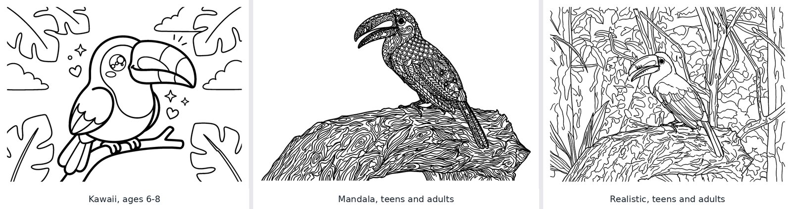
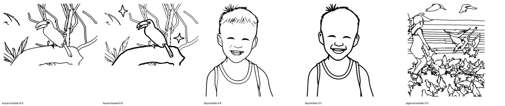

# Line-art spike (2026-10-30)

Phase 1 started by checking that Gemini can turn real photos into usable coloring pages before
any UI existed. Script: [`scripts/spike.py`](../scripts/spike.py). Model: `gemini-3-pro-image` on
Vertex AI.

## Setup

Five free-licensed photos from Wikimedia Commons, chosen to cover the risky cases:

| Photo | Why | Author, license |
|---|---|---|
| Keel-billed toucan on a branch | Educational bird book; dark subject | Bernard Gagnon, CC0 |
| Las Lajas Sanctuary | Famous landmark; busy landscape | Diego Delso, CC BY-SA 4.0 |
| Two dogs on grass | Family photo; small subject, heavy texture | சீதா லெட்சுமி நாராயணன், CC BY-SA 4.0 |
| Laughing boy | Photo of a child (safety filters) | Basile Morin, CC BY-SA 4.0 |
| Girl with pigeons in a square | Crowded scene with a child | Ken Ketch, CC BY 2.0 |

Each photo in both styles (`realistic`, `cartoon`) and all three age groups: 30 conversions, then a
second round of 6 with the revised prompt. 39 images in total (the 36 above plus 3 not itemized
here), about **$6.60** as logged then
(~$0.17 per image: ~1,400 output tokens, all billed at the image rate of $120/M). The thinking
tokens in that count are billed at the text rate ($12/M), so the real cost was closer to $0.14 per
image; `usage.py` prices them that way since 2026-10-31.

## Findings

**It works.** The subject stays recognizable in both styles and every age group: the toucan is a
keel-billed toucan, the boy is the same boy, Las Lajas keeps its bridge and spires.

**Photos of children were never blocked** (12 conversions with children, 0 refusals).

**The model is not trustworthy about black and white**, which is why `lineart.clean` exists:

| What the model did | Fix |
|---|---|
| Copied the photo's colors (green and red beak, yellow chest) | Prompt puts "no color" first; cleanup ignores saturated pixels |
| Filled dark parts solid black (the toucan's body) | Prompt: dark parts are outlines with white inside; cleanup hollows big fills to their outline and keeps small ones (pupils) |
| Drew thin lines when asked for very thick ones | Prompt gives the line width as a fraction of the image width; cleanup thickens step by step |
| Returned a *photo of a printed coloring page on a table* | Prompt asks for flat artwork, no paper; cleanup detects a non-white border, cuts the sheet out, removes the paper edges |
| Added a third, bigger puppy to the dog photo | Prompt: draw exactly the animals, people and objects in the photo |
| Drew grass and fur as hundreds of loose strokes | Prompt: textures are a few closed clumps |
| Over-detailed busy scenes for ages 3–5 | Prompt: at 3–5 any background is a few big shapes, even in a busy scene |

**Cleanup must not make things worse.** Growing every line to the 3–5 minimum width merged the
pigeons into black blobs. Thickening now stops before areas big enough to color at that age start
closing up, or the page gets too dark.

**Output resolution: correction (2026-10-31).** The spike saw about 1 MP (1200×896) even when
asking for `2K`. That was a bug in `gemini.generate_image`: the model thinks with low-resolution
draft images (response parts marked `thought`) before the final one, and the client returned the
first image it found, a draft. It now returns the final image, which has the requested size
(1792×2400 at `2K`, 3584×4800 at `4K`). Every conversion in this spike, and every page converted
before the fix, used the draft; the cleanup upscales to 2400 px before thresholding, so they print
fine, but the prompts were tuned on drafts. Re-running the spike on the final images is pending.

## New styles (2026-10-31)

Two styles, `kawaii` and `mandala`, and an `adult` level (intricate, fine lines; cleanup minimum
stroke 4 px at 2400 px) were added. Checked on the toucan photo, one conversion each, final 2K
images (after the draft-image fix): kawaii at 6–8 with *simplify*, mandala at adult with
*remove*, realistic at adult with *keep*. All three were clean on the first try (no cleanup
warnings): kawaii gave round shapes, big eyes and a few hearts and stars; mandala filled the
bird with scales, petals and swirls as closed areas; realistic adult drew the whole forest in
fine lines. About $0.42.

## Stable Diffusion (2026-11-02)

A second, optional engine for coloring pages (`stable_diffusion.py`): a stable-diffusion.cpp
server (`sd-server`) running FLUX.1 Kontext [dev], reached through its OpenAI-style
`/v1/images/edits`. Checked on three of the photos above (toucan, laughing boy, girl with
pigeons), sent at 768 px on the long side with 12 sampling steps, and compared with Gemini's
pages in `docs/images`. Twelve conversions in all, one at a time: **70–90 s each**, no cost per
image.

**Kontext wants a short instruction.** Its guide recommends short, imperative English; the long
Gemini prompt is not used. A first round tried three wordings on the toucan and two on the boy
and the pigeons: a plain "convert this photo into a black and white coloring book page", one
for ages 6–8 asking to simplify the background, and a cartoon one for ages 3–5. The prompt in
`imaging.build_sd_prompt` is the plain one plus the age, the style, "draw the eyes and faces
clearly" (the boy came out almost without eyes) and the background. The second round used it:

What it does:

- **Every page was clean**: all 12 passed `lineart.clean` with no warnings, no copied colors,
  no black fills, no paper mockups. It returns the photo's size, so the cleanup upscales from
  768 px; at print size the lines are a little softer than Gemini's.
- **Simple subjects and ages 3–5 are its strength**: the boy as a cartoon for 3–5 is as good as
  Gemini's, and with the eyes line the realistic one keeps his laughing face.
- **It keeps the photo.** It hardly ever simplifies or invents: "simplify the background" was
  ignored every time (the toucan keeps every branch), it draws less inner detail than Gemini
  (no feathers), and kawaii only adds a couple of stars. The crop and SAM2 (on the `SAM` branch)
  are the ways to change the framing.
- **Crowded scenes get muddled**: the pigeons become a tangle of overlapping outlines, even for
  3–5, where Gemini draws each bird. Use Gemini for those.

Not checked yet: `remove` background, mandala, adults, and sizes other than 768 px.

## Still open

- **Small subjects.** When the subject fills a small part of the photo (the dogs), the model keeps
  the framing even when told to zoom in. The workbench has a crop control so the user can frame
  the subject before converting.
- **Busy scenes at ages 3–5** stay busier than ideal. The page warns; the user can switch the
  background to *remove* or add instructions.
- The model's randomness is real: the same prompt gave a perfect page once and a mockup photo the
  next time. Regenerate is a first-class action in the workbench.
