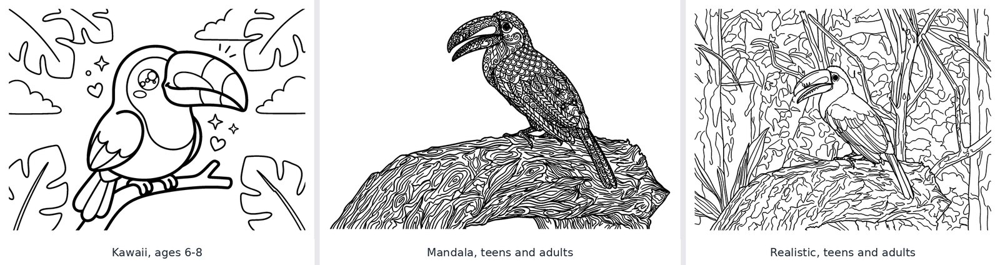

# User guide

## A book from start to finish

1. **Create the book** on the home page: title, subtitle, kind of book (template), style, age
   group and book language. All of it can be changed later in **✏️ Edit book** (sidebar), along
   with the dedication and a second language; the page size and the other print options are in
   **📄 Export PDF**.
2. **Add photos** in **🗂️ Pages → 📷 Add photos**. Select many at once; each becomes a page in the
   order you uploaded them. Or paste a **Wikimedia Commons** link: the photo comes with its
   author, license and link already filled in.
3. **Convert**. In **🗂️ Pages**, **✨ All with Gemini** draws every page that has no drawing
   yet, three at a time, with the estimated cost on the button; **🖌️ All with Stable Diffusion**
   does it on your own server, one at a time, with the estimated minutes (**✏️ Free draft of all**
   does it for free). Or go page by page in the **🎨 Workbench**:
   - **Crop** the photo first if the subject is small in it. The model keeps the photo's framing,
     so a dog in a corner of a lawn becomes a page full of grass.
   - **✨ Gemini** takes 30–40 seconds and costs about $0.14. **🖌️ Stable Diffusion** (when set
     up) takes 1–2 minutes on your own server and costs nothing per image; it does well with one
     subject and simple pages for small children, less so with crowded scenes, and it tends to
     keep the photo's background. Do not touch the app while it draws. **✏️ Free draft** is
     instant and free, but it only traces the photo's color areas: use it to lay out a book, not
     to print.
   - Not happy? Add **extra instructions** ("only the bird, not the branch", "remove the people in
     the back"), change the page's **style** or **background**, and regenerate. Every attempt is
     kept under **Versions**; pick the one you like.
   - Warnings under the page tell you when the cleanup had to fix something (copied colors, black
     fills, a photo of a printed page). They never block; regenerate if the result looks off.
   - **✅ Approve and next** moves to the next page.
4. **Write the caption** next to the photo: a title, a subtitle and an info text, printed in the
   box under the coloring page, and the photo's **credit and license**.
5. **Export** in **📄 Export PDF**: choose the options and the extra pages, check the summary,
   **Build PDF**, preview it and download it.
6. **To sell it**, go to **🛒 Amazon KDP** ([Selling on Amazon](#selling-on-amazon)).

## Kinds of book, styles, ages and backgrounds

| Setting | Options | Effect |
|---|---|---|
| Kind of book | Free, Nature and animals, Places and landmarks, Family album | Suggests the background and the labels of each page's info text ("Where it lives:", "Fun fact:"…), which **📋 Insert the template's labels** puts in an empty info box. |
| Style | Realistic, Cartoon, Kawaii, Mandala | Field-guide drawing traced from the photo; a friendly cartoon; a cute, round kawaii version with little hearts and stars; or the subject filled with decorative patterns. |
| Age | 3–5, 6–8, 9+, Teens and adults | Line weight and how many areas there are to color: from very thick lines and a few big areas to fine lines and hundreds of small ones. The activities follow it too. |
| Background | Keep, Simplify, Remove | Keep the setting, reduce it to a few shapes and zoom in on the subject, or draw the subject alone. |

Style and background are set per book and can be overridden per page. The age group is per book.
Changing any of them affects new conversions only.



## Captions

- **Title**: the name of what is being colored ("Tucán pico iris", "Palomas en la plaza").
  It also tells the model what the subject is, so write it before converting.
- **Subtitle**: a scientific name, a place, a date.
- **Info**: free text. A line that starts with a short label and a colon gets the label in bold:

  ```
  Dónde vive: bosques tropicales húmedos
  Dato curioso: su pico es enorme pero liviano
  ```

- **Photo credit** and **license**: who took the photo, and what the license allows (own photo,
  public domain or CC0, CC BY, CC BY-SA, free for commercial use, non-commercial, no derivatives).
  Credits are printed on the copyright page, not under the drawing. **🔎 Fill from Wikimedia
  Commons** reads both from the photo's Commons link. A book for sale needs the right to use every
  photo: see [Rights to the photos](amazon-kdp.md#rights-to-the-photos).

The caption text shrinks to fit the box. If it still does not fit, the workbench and the export
summary warn you and the PDF cuts it at the edge of the box.

### Bilingual books

Choose a **second language** in **✏️ Edit book**. Each page then has a **🌐 Text in …** section
under its caption: type the translation, or **🌐 Translate this page with AI** (or all the
missing ones at once; a few cents each). The PDF prints the translation under the caption,
smaller, and the fixed labels ("This book belongs to", the activity titles, the closing line) in
both languages. Check the translations before printing.

## Export options

| Option | Default | What it does |
|---|---|---|
| Page size | Letter | Letter (*carta*), A4, 8 × 10 in or square 8.5 × 8.5 in. |
| Cover | First page | Which coloring page goes on the title page, which is the cover when you print at home (also from **🗂️ Pages → Use as cover**). The KDP cover uses it too when it has no cover image. |
| Reference photo on every page | On | The small color photo in the info box. |
| "This book belongs to" page | On | A page for the child's name after the cover. |
| Blank back on every sheet | Off | For double-sided printing, so markers never bleed into another drawing. Turn it on for Amazon. |
| Extra pages | None | See below. |
| Copyright page | Empty | Text for the page behind the title page (© year and author, rights, ISBN), printed with the photo credits. With no text and no credits there is no copyright page. |

**Extra pages**, all made from the book itself, never by the AI, and the same every time you
export:

| Page | Where | What it is |
|---|---|---|
| 🎨 Color test | After the owner page | Boxes to try each crayon or marker and write its name. |
| 🔤 Word search | After the coloring pages | One word from each page title (the longest), hidden across and down for ages 3–5, also diagonally for 6–8, in every direction from 9 up. Needs at least 3 titled pages. |
| 🌀 Maze | After the coloring pages | Bigger and more intricate with the age group. |
| 🔢 Connect the dots | After the coloring pages | A drawing whose outline becomes numbered dots, with the details inside left to color. It uses a page converted with **No background** (the subject alone), or the drawing you pick. |
| ✅ Solutions | After the activities | The word search, the maze and the finished drawing. |
| 🏅 Diploma | Near the end | "Congratulations! … for coloring the whole book", with lines for the name, date and signature. |
| 📖 Closing page | Last | "Colorín colorado, este libro se ha acabado." (in English: "Snip, snap, snout, this tale's told out.") |

The export view tells you when an activity cannot be made yet and why. With blank backs, each
extra page adds two pages to the book.

The fixed labels of the PDF follow the **book language**, not the app language: a Spanish app can
make an English book. Pages without a coloring page are skipped; pages not yet approved are
included and listed in the summary. Every build is a new file in `books/<slug>/exports/`.

## Selling on Amazon

**🛒 Amazon KDP** shows what Amazon's print-on-demand service would make of the book:

- **Interior ink** (black, standard color, premium color), **store** (Amazon.com, Amazon.co.uk,
  or Amazon.es and the rest of the EU) and **list price** before VAT, with the page count, spine
  width, printing cost and royalty per copy, and the lowest price KDP accepts.
- **Before uploading**: errors that block publishing (too few pages, a price under the minimum, an
  ink KDP does not offer in that size, photos whose license forbids selling) and warnings (no blank
  backs, photos without a license or a required credit, no copyright text, pages not approved),
  plus the AI disclosure reminder.
- The settings to choose when uploading to KDP.
- **📝 Amazon listing**: **✨ Suggest with AI** drafts the description (simple HTML), seven
  keywords, three categories and the reading age from the book's pages; edit them and copy them
  into KDP.
- **KDP cover**:
  - **Front cover image**: the cover page's drawing (uncolored), an image you upload (a portrait,
    full-color illustration without text, about 2600 × 3400 px to print sharp), or one the AI
    draws in 4K, about $0.25 each:
    - **A collage of pages**: pick up to six pages; the AI redraws them together and colors them
      in with the real colors of their photos, outlines visible.
    - **A description** you write.
    - **The book's theme**: the title, subtitle and page titles.

    Every image is kept as a version (v1, v2…); choose which one the front uses. The title goes on
    a label in the background color over the top of the image.
  - **Color and text**: background color, and the text for the back cover.
  - **Build cover** makes the wraparound PDF. Build it again whenever the interior's page count
    changes; the view warns when it is stale.
- **🖼️ Images for the listing and social media**: a 3D mockup of the book, three pages from inside
  and the front cover alone, made from the book's own PDFs, in a ZIP.

[Selling on Amazon](amazon-kdp.md) has the full specs, costs, rules and the KDP setup steps.

## Backups and copies

Each book on the home page has **Duplicate** (a full copy, to try another style or make a second
edition) and **📦 ZIP** (photos, versions and cover images in one file, without the exports,
which you can rebuild). **📥 Import a book** adds a ZIP made that way as a new book; it never
replaces one.

## Languages

The **🌐 Idioma · Language** selector in the sidebar switches the whole app between Spanish and
English and is remembered. Captions are printed exactly as you type them; only the
[bilingual](#bilingual-books) translation is written by the AI, and only when you ask.

## Costs

Each AI conversion is one image from `gemini-3-pro-image`, about **$0.14**; a cover image in 4K is
about **$0.25**; a translation or a listing draft costs a fraction of a cent. A 20-page book with
one or two attempts per page costs about $4.

Every Gemini call is logged with its tokens and estimated cost. The sidebar shows the open book's
spend, images and tokens; **📊 Usage & costs** on the home page shows the totals (calls, images,
tokens, cost) and splits them by book and by operation. Calls made outside a book, like the
connection test, appear as "no book". Estimates use public list prices; your Google billing is the
source of truth.
